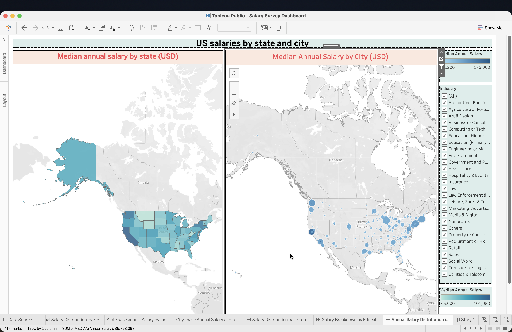
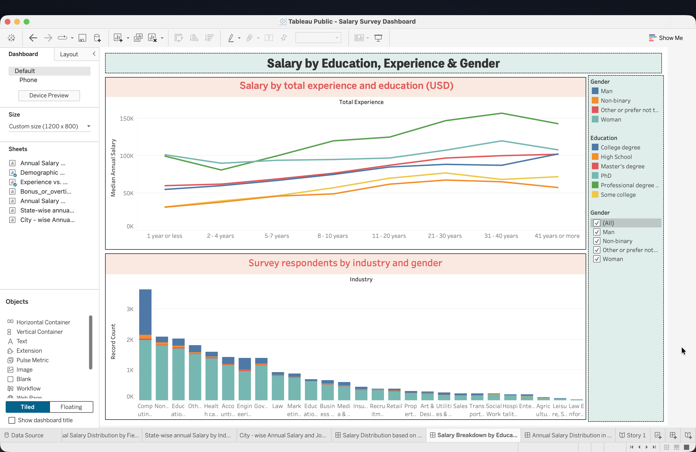
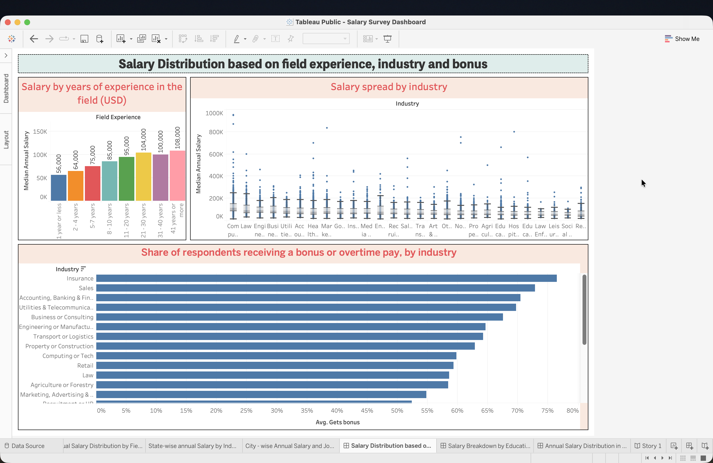

# US Salary Survey Dashboard (Tableau + Python)

Interactive Tableau dashboards on the Ask a Manager Salary Survey 2021: median salaries by US state and city, by education and experience, by industry, and how common bonuses are. The survey data is cleaned in Python (pandas) and visualised in Tableau.

**Live dashboard:** [Salary Survey Dashboard on Tableau Public](https://public.tableau.com/views/SalarySurveyDashboard_17942771140100/Story1)

Individual work within a team project for the module Data Management 1, MSc Applied Data Science and Analytics, SRH University of Applied Sciences Heidelberg (Hamburg campus), first semester (November 2024). Revised in November 2026.



## At a glance

| | |
|---|---|
| **Data** | Ask a Manager Salary Survey 2021: 28,089 responses; 22,576 used after cleaning (US respondents paid in USD) |
| **Cleaning** | Python (pandas): duplicate removal, country and currency filter, industry and state grouping, salary plausibility range; 76 tests (pytest) |
| **Visualisation** | Tableau: 3 dashboards (7 worksheets) and a story, published on Tableau Public |
| **Stack** | Python, pandas, openpyxl, pytest, Tableau Desktop (Public Edition), Tableau Public; original cleaning in Tableau Prep Builder |

## Key findings

All values are median annual salaries in USD (2021) for US respondents.

- **Location:** highest in California ($101,050), Washington ($91,100), New York and Washington DC ($90,000 each); among states with at least 100 responses, lowest in Oklahoma ($54,040) and South Carolina ($57,000).
- **Education:** from $56,000 (high school) to $97,000 (PhD) and $120,000 (professional degrees such as MD or JD).
- **Experience:** from $56,000 with 1 year or less in the field to $108,000 with 41 years or more.
- **Bonuses:** 47% of respondents receive a bonus or overtime pay — 76% in insurance and 73% in sales, but only 14% in higher education.

These describe the survey's respondents, not the US workforce (see Limitations).

## Dashboards

1. **US salaries by state and city** — median salary per state (filled map) and per city (cities with at least 5 responses; dot size = number of responses), filterable by industry.
2. **Salary by education, experience and gender** — median salary by total experience for each education level (filterable by gender), and survey respondents by industry and gender.
3. **Salary by field experience, industry and bonus** — median salary by years of experience in the field, the salary spread per industry (box plot; each dot is one job title's median salary), and the share of respondents receiving a bonus or overtime pay per industry.

The dashboards are combined in a Tableau story with short findings and a note on the data.





## Data cleaning

The raw survey has free-text answers for country, city, industry and currency. `cleaning/clean_salary_survey.py` turns it into the dataset used by the dashboards:

| Step | Rows | Removed |
|---|---|---|
| Raw survey responses | 28,089 | |
| Remove duplicate submissions (identical in every answer, different timestamp) | 27,937 | 152 |
| Keep US respondents paid in USD | 23,027 | 4,910 |
| Remove rows with missing education, gender or city | 22,707 | 320 |
| Keep annual salaries from $15,000 to $1,000,000 | 22,576 | 131 |

- **Country:** clear spelling variants of the United States (for example "US", "U.S.A.", "United States of America") are recognised; 235 responses paid in USD with another or unclear country are excluded.
- **Salary range:** the survey asked for the annualised full-time salary; $15,000 is roughly a full-time job at the US federal minimum wage ($7.25 × 2,080 hours ≈ $15,080). Values above $1,000,000 (such as 10,000,000) are treated as entry errors.
- **Industry:** the survey's 26 standard answer options are kept, matching spelling and capitalisation variants; other free-text industries are grouped as "Others" (1,818 responses).
- **State:** kept as answered, including District of Columbia; answers naming several states (103) are grouped as "Multiple states" and left out of the state map.

Every rule and the row counts are recorded in [`results/cleaning_report.json`](results/cleaning_report.json).

### What changed from the 2024 version

The first version (November 2024) was cleaned in Tableau Prep Builder; the original flow and workbook are kept in [`original_2024/`](original_2024). Reviewing it in 2026 showed problems that the Python cleaning fixes:

- Salaries in six currencies (USD, CAD, GBP, EUR, AUD/NZD and others) were compared without conversion. The revised version uses US respondents paid in USD only.
- Several countries were grouped under the wrong country (for example Bulgaria and Chile under USA), and some states under the wrong state (District of Columbia under South Dakota, Kentucky under Connecticut).
- The duplicate check did not compare whole responses, and extreme salary entries (up to 43.8 million) remained.
- Charts used the maximum or the average of salaries, stacked values that cannot be added, and showed a pie chart of averages. They now use medians, lines, bar charts and a box plot.

## Repository structure

```
cleaning/                   Python cleaning script and grouping rules
data/                       Raw survey (Excel) and cleaned dataset (CSV)
tableau/                    Revised Tableau workbook (2026)
original_2024/              Original Tableau Prep flow, workbook and extract (2024)
results/cleaning_report.json  Row counts and rules of the cleaning
docs/                       Dashboard screenshots
tests/                      pytest tests for the cleaning rules
```

## Reproduce

```bash
git clone https://github.com/samu2421/salary-survey-tableau-dashboard.git
cd salary-survey-tableau-dashboard
python3 -m venv .venv
source .venv/bin/activate
pip install -r requirements-dev.txt
python -m cleaning.clean_salary_survey --min-salary 15000 --max-salary 1000000
pytest
```

This rewrites `data/salary_survey_usa_clean.csv` and `results/cleaning_report.json`. To open the workbook, use Tableau Desktop or the free Tableau Desktop Public Edition; when asked for the data source, select `data/salary_survey_usa_clean.csv`.

## Limitations

- **Self-selected sample.** Respondents are readers of the Ask a Manager blog; 78% are women. The results describe the survey's respondents, not the US workforce, and the gender chart shows who answered, not the gender mix of each industry.
- **USA only.** Responses from other countries and currencies are not analysed.
- **2021 salaries**, not adjusted for inflation.
- **Free-text answers.** Cities and industries were typed by respondents; some cities cannot be placed on the map, and "Others" collects industries outside the standard options.
- **Small groups.** Some states, cities and education-experience combinations have few responses; tooltips show the number of responses.

## Credits

- Data: Ask a Manager Salary Survey 2021 by Alison Green, published on [askamanager.org](https://www.askamanager.org/2021/05/look-at-24000-peoples-real-life-salaries.html). No licence is stated for the data; it is included here for reproducibility and analysed for educational purposes.
- Tools: Tableau Desktop Public Edition and Tableau Public; Python with pandas.

## Project context

The module project was a team project with Piyush Kulkarni: each of us cleaned and analysed the same dataset and built separate dashboards. The Tableau Prep flow, the workbooks and the Python cleaning in this repository are my work. The 2026 revision (Python cleaning, tests and chart changes) was carried out with AI coding assistance.